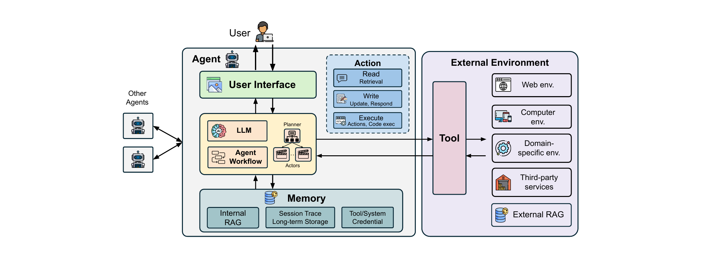

# From language models to agentic systems

An **AI agent** is a hybrid software system that combines traditional software components with neural components. The definition is built on earlier agent definitions in the literature [35, 72, 114, 135] and is tailored for the security analysis that follows; it does not claim to be superior to them. This chapter makes that definition concrete — what the parts of an agent are, how they fit together, and what makes the result different from ordinary software — because the entire security argument rests on it.

## Scope

The work focuses on security risks and defenses that are unique to agentic systems, or significantly amplified in them, compared with traditional software and standalone LLMs. It first characterizes how agents differ from standalone models across seven design dimensions (§3). It then analyzes agent-specific security risks at both the component level and the system level (§4). For risks that also exist in non-agentic LLMs — jailbreak and hallucination — it emphasizes how agent autonomy and environment access magnify their impact, so that a jailbreak becomes data exfiltration and a hallucination becomes unintended system manipulation. Attacks that target model internals, such as model inversion [38], are excluded, because they do not fundamentally worsen in agentic settings, where agents operate purely through inference-time input and output interfaces. The defense landscape is then systematized in §5.

## Methodology

The agent structure and the design dimensions are defined from existing definitions and from real-world agent implementations. That definition is the foundation of the agent risk taxonomy, which analyzes risks at both the component and the system level and takes cues from the taxonomy of the OWASP Top 10 for LLM Applications [104] and the MITRE ATLAS matrix [25]. The defense landscape is then proposed by applying the defense-in-depth principle, informed by traditional system security.

Over that framework, the work reviews academic literature and web documents on agentic AI security from 2023 to October 2025, the period that corresponds to the proliferation of agent systems [150]. The search uses keywords across four dimensions: general terminology (agent security), OWASP-defined risks (prompt injection, memory poisoning), component-centric terms (RAG security, tool security), and traditional security adaptations (isolation, access control). It prioritizes top-tier security venues (USENIX Security, IEEE S&P, CCS, NDSS) and machine-learning conferences (NeurIPS, ICLR, ICML), alongside high-impact preprints, industry whitepapers, and CVEs. Work on standalone models is excluded by hand, so that only agents remain. The review yields 128 papers, including 51 attack methods and 60 defense methods; the remaining works address both attacks and defenses, or are case studies that introduce no new method.

## Differences from existing surveys

Existing surveys on AI and LLM security emphasize model-level threats and overlook the expanded attack surface and the downstream consequences that agentic systems introduce [49, 58, 81, 138]. Prior agent-focused studies narrow their scope to specific attack vectors [155], agent types [65, 73], or individual components [52], while design-oriented work proposes high-level principles without systematizing attacks or defenses [12, 156]. The closest surveys [31, 151] do consider cross-component interactions, but largely limit their defense taxonomies to model-based techniques. This work instead provides a unified risk taxonomy covering all agent components and their interactions, together with a defense-in-depth framework that integrates model-based and system-level defenses.

## The structure of an AI agent

An agent is built from a small set of parts. The LLM is the brain: the LLM or LLMs receive and analyze user tasks, create a step-by-step plan, and take actions that follow the plan. These processes can be carried out by a single LLM or by several, each tailored to a specific role. Alongside the LLM sits the agent workflow, which sequences the steps the LLM decides on; together the LLM and the workflow form the decision-making core of the agent. Memory stores the agent's internal knowledge base and its historical action trajectories, which may include past experiences and observations; this information is often vectorized for efficient retrieval, and it lets the agent make future decisions using its knowledge and prior experience. In the structure it appears as internal RAG, a session trace, long-term storage, and tool or system credentials.

Tools are the symbolic functions the agent uses to interact with the external environment. With tools, an agent can perform three types of actions: read, write, and execute. This is the agent's action space, and it is worth separating two cases. Retrieval tools provide read-only access to the external environment, such as searching or reading a file. Tools that modify the environment, such as writing a file, sending an email, or running a command, have read, write, and execution access. Tools can be implemented through standardized protocols such as MCP [6], by the agent designer, or by third-party providers [8, 105].

The user interface is the surface the user interacts with, ranging from text-only interaction to web-based previews and media rendering and on to fully interactive web elements. It sits between the user and the agent, and it is also where other agents attach in a multi-agent setting.

The external environment is the context outside the agent in which it acts to accomplish tasks. Different agents operate in different environments: a web agent typically interacts with a browser, while a code agent operates within an integrated development environment (IDE). The agent reaches the environment through its tools — for example to access, read, and write a SQL database. The environment divides into sub-environments: the web, the computer, a domain-specific environment, third-party services, and an external RAG. Reading the whole picture, a user query enters through the user interface, the decision-making core plans and selects actions, and each action leaves the agent either as a retrieval that reads the environment, as a write or response that updates it, or as code that the environment executes. Multi-agent systems have several such cores, each with its own memory, system prompts, and tool sets.

An agent receives a user query and automatically takes a sequence of actions to assist the user. The LLM components conduct task planning and decide what actions to take for different tasks, including a tool call, content generation, and querying memory. When asked to update a file, for example, the agent first calls a file read tool, generates new file content based on what it reads, and calls a file write tool to update the file.

## Agentic systems versus traditional software systems

The key uniqueness of agentic systems compared with traditional systems lies in their composition and their workflow. In composition, agent systems combine traditional software programs with AI models, whereas traditional systems operate mainly on pre-determined program logic defined in source code; the presence of a model makes agentic systems more flexible and adaptive. In workflow, the control flow of traditional software is mainly pre-programmed, whereas agentic systems run on dynamically generated workflows, so the sequence of operations is decided at run time rather than fixed in advance.

## Design flexibility as the organising axis

The two differences above are consequences of a single property: flexibility. An agent's design can be placed on a continuum of flexibility along seven dimensions — input trust, access sensitivity, workflow, action, memory, tool, and user interface. Each dimension runs from a least flexible level through a moderately flexible level to a most flexible level. Input trust runs from no external data to arbitrary external data; access sensitivity from no sensitive data to arbitrary sensitive data; workflow from a simple chatbot to a dynamic, LLM-defined workflow; action from an LLM response only to response, retrieval, and execution; memory from no memory to persistent cross-session memory; tool from no tool to arbitrary tools; and the user interface from text-only to interactable web elements. The dimensions are orthogonal: one agent can sit at different levels on different ones at the same time.

This flexibility is the axis the whole systematization is organized around. Moving a dimension toward its most flexible end buys capability and, in the same motion, widens what an attacker can reach and how far a failure can propagate. The attack landscape and the defense landscape are both read off that axis: the risks an agent carries and the defenses that contain them follow from how flexible its design is. Chapter 3 sets out the seven dimensions and their security consequences in detail.

## Key points

- An AI agent is a hybrid software system combining traditional software components with neural components, a definition built on earlier ones and tailored for security analysis.
- The parts are the LLM and agent workflow (the decision-making core), memory, tools, the user interface, and the external environment; multi-agent systems hold several such cores, each with its own memory, prompts, and tools.
- Agent actions are of three types — read, write, and execute — where retrieval tools give read-only access and modifying tools carry read, write, and execution access.
- The external environment divides into web, computer, domain-specific, third-party service, and external RAG sub-environments.
- Agentic systems differ from traditional software in composition (AI models alongside pre-determined program logic) and in workflow (dynamically generated rather than pre-programmed).
- The seven design dimensions form a continuum of flexibility that is the axis the entire risk-and-defense analysis is organized around.
- The methodology reviews 128 papers, including 51 attack methods and 60 defense methods, covering work from 2023 to October 2025.
