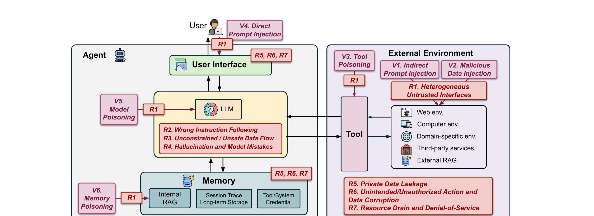

# Attack vectors

An attacker reaches an agentic system through a small number of entry points. The paper groups them into six attack vectors, `V1` through `V6`, separated by what the adversary must control, and pairs each entry point with the security risk it produces. Figure 2 shows the landscape as a whole: the black boxes and arrows are the agent's components and data flows, the purple boxes and arrows are the attack vectors and how they enter the system, and the red boxes are the security risks.

## Threat model

The participants in an agent ecosystem are diverse, so attacker and victim change from one scenario to the next. The paper sorts adversaries into three types by capability, and attaches to each type the vectors it can carry out.

### External adversary

An external adversary cannot interact with the agent. What the adversary controls is the outside world the agent may later read: public web pages, documents, and the other resources the agent retrieves and processes. This is the most constrained of the three models and also the most realistic, because it assumes no access to the agent system at all. It carries `V1`, `V2` and `V3`.

### User-level adversary

A user-level adversary reaches the agent directly and feeds it malicious input. The adversary is either a malicious user, or a third party that poisons the input of an otherwise benign user. It carries `V4`.

### Internal adversary

An internal adversary has access to agent components and compromises the agent from inside. The adversary may be the agent developer, or a third-party provider responsible for a single component such as the memory or the model. The paper states that this attack is the most difficult to achieve in practice. It carries `V5` and `V6`.

## Attack vectors

In Figure 2 every vector's arrow itself ends at a box for `R1`, heterogeneous untrusted interfaces: whatever the vector, the first risk it produces is an exposed interface through which untrusted data enters the agent. The figure marks `R5`, `R6` and `R7` at the user-interface, tool and memory boundaries, where that data leaves the system again. Section 4.3 gives the cascade that connects the two: an expanded attack surface (`R1`) lets attacker-controlled data reach the model risks (`R2` wrong instruction following, `R3` unconstrained data flow, `R4` hallucination and model mistakes), and those then amplify the consequence risks `R5`, `R6` and `R7`.

### V1. Indirect prompt injection

The adversary crafts content that the agent will retrieve, and puts instructions inside it. When the agent reads that content, the injected instruction competes with the user's real goal and can push the agent into actions nobody asked for, most often unauthorized access to the agent user's data or to the agent provider's internal resources. The delivery channel is anything the agent ingests from outside: retrieved web content, retrieved or attached documents, email, and the results that tools return. The paper's own incident record already holds the pattern, prompt injection used to reach private GitHub repositories [54], and the introduction cites data exfiltration through malicious document attachments and email forwarding [112, 117]. Named prior work includes Greshake et al.'s compromise of real-world LLM-integrated applications by indirect prompt injection [48] and InjecAgent, a benchmark for indirect prompt injection in tool-integrated LLM agents [153]. Appendix A maps `V1` onto three MITRE ATLAS techniques: Retrieval Content Crafting, Drive-by Compromise, and Prompt Infiltration via Public-Facing Applications. `V1` enters from the external environment and terminates at `R1`.

### V2. Malicious data injection

Here the adversary injects data, in addition to prompts. The distinction is that injected data does not have to read as a command at all; it only has to be consumed during a sensitive operation, where it triggers a security failure or a breach. The paper gives two shapes of this. One is a malicious software package: attackers register packages under names that code-generating models frequently hallucinate, turning a model limitation into a reliable supply-chain channel [127], which is the exploitation Section 4.2 ties to `R4`. The other is attacker-supplied values for sensitive parameters, such as the financial values a Web3 agent acts on [106]. `V2` enters from the external environment and terminates at `R1`.

### V3. Tool poisoning

The adversary supplies a third-party tool. The payload can sit in one of two places. It can be text, a malicious prompt embedded in the tool's name or description, which the model reads while deciding whether and how to call the tool; or it can be the tool's implementation, meaning the tool simply contains malicious code. The description channel is what sets this vector apart from `V1`: the payload does not need to be retrieved from the environment, because it arrives with the tool definition the agent loads. The paper cites cross-tool harvesting and polluting in multi-tool LLM agents [74], a report on how MCP servers can attack the user [96], and an attack on tool selection in LLM agents [121]. `V3` enters through the tool component and terminates at `R1`.

### V4. Direct prompt injection

A user-level adversary writes a prompt that instructs the agent to perform actions the system prompt forbids, so the malicious instruction arrives directly instead of through retrieved content. The adversary is a malicious user or a third party that poisons benign input. The paper cites a body of prompt-injection work: automatic and universal prompt injection attacks [79], prompt injection against LLM-integrated applications [80], Perez and Ribeiro's "Ignore previous prompt" attack techniques [107], and goal-guided generative prompt injection [154]. The two poisoning works are Imprompter, which tricks LLM agents into improper tool use [39], and visual adversarial examples that misuse tools by perturbing what the model perceives [40]. Appendix A equates `V4` with the ATLAS technique LLM Prompt Injection. `V4` enters at the user interface and terminates at `R1`.

### V5. Model poisoning

The adversary embeds hidden malicious behaviour into the model itself, so that the model performs unauthorized actions or leaks user data. The adversary sits inside, as the model provider or a third party in the model supply chain, which is why this vector belongs to the internal adversary and therefore to the class of attacks the paper calls the most difficult to achieve in practice. Appendix A expands `V5` into three MITRE ATLAS techniques: Poison Training Data, Publish Poisoned Datasets, and Publish Poisoned Models. The paper cites [19] and [91] for this vector. `V5` enters at the LLM and terminates at `R1`.

### V6. Memory poisoning

The adversary manipulates the agent's memory directly, to inject malicious content, change how the agent behaves, or leak private data. Memory is what makes this different from a one-off injection: it holds internal RAG, session traces, long-term storage and tool or system credentials, and it persists across sessions, so a single write outlives the conversation that made it. The paper cites AgentPoison, which red-teams LLM agents by poisoning their memory or knowledge bases [21], a practical memory injection attack against LLM agents [34], and PoisonedRAG, which corrupts the knowledge of retrieval-augmented generation [162]. Appendix A expands `V6` into the ATLAS techniques RAG Poisoning, False RAG Entry Injection, and AI Agent Context Poisoning. `V6` enters at the memory component and terminates at `R1`.

## Key points

- Adversaries are classified by capability into three types: the external adversary, which has no access to the agent system and acts only through resources the agent may retrieve; the user-level adversary, which feeds the agent malicious input directly; and the internal adversary, which has access to agent components such as the model or the memory.
- The three types carry the vectors in order: `V1`, `V2` and `V3` for the external adversary, `V4` for the user-level adversary, and `V5` and `V6` for the internal adversary, whose attack the paper calls the most difficult to achieve in practice.
- `V1`, indirect prompt injection, delivers instructions through content the agent retrieves, such as web pages, documents, email and tool results, and underlies the paper's cited GitHub-repository and document-exfiltration incidents.
- `V2`, malicious data injection, supplies data rather than instructions, such as hallucinated package names or attacker-chosen sensitive parameter values, and becomes dangerous when that data is consumed during a sensitive operation.
- `V3`, tool poisoning, hides its payload in a third-party tool's name or description or in the tool's implementation, so the payload arrives with the tool definition rather than being retrieved.
- `V4`, direct prompt injection, reaches the agent from the user or the user interface and contradicts the system prompt; the paper equates it with the MITRE ATLAS technique LLM Prompt Injection.
- The two internal-adversary vectors, `V5` model poisoning and `V6` memory poisoning, correspond to the ATLAS techniques Poison Training Data, Publish Poisoned Datasets and Publish Poisoned Models, and RAG Poisoning, False RAG Entry Injection and AI Agent Context Poisoning respectively.
- In Figure 2 every vector terminates at `R1`, heterogeneous untrusted interfaces, while `R5`, `R6` and `R7` are marked at the user-interface, tool and memory boundaries, and Section 4.3 describes how `R1` leads to the model risks `R2`–`R4` and then to `R5`–`R7`.
