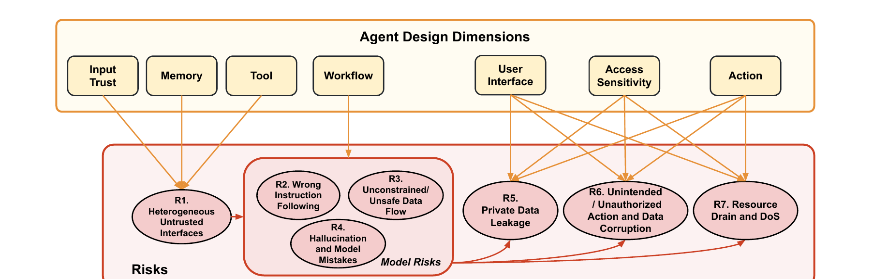

# Security risks

A standalone language model is reached through one interface, the prompt; an agent through several at once. The risk taxonomy of §4.2 is organized around them: each risk is keyed to a component an attacker can target, and the seven entries R1–R7 are the vocabulary the rest of this book uses. It is dimensional rather than a severity ranking, and one incident normally exercises more than one entry. Damage is spread unevenly across the classical goals: confidentiality covers R3 and R5, integrity covers R1, R2, R3, R4 and R6, and availability covers R7.

## R1. Heterogeneous Untrusted Interfaces

An agent exposes multiple heterogeneous interfaces: external data sources it retrieves, persistent memory stores that accumulate over time, and third-party tools of varying trust level. Each is an attack entry point, and together they produce a far larger attack surface than a standalone LLM's. Every vector V1–V6 in the attack-landscape figure enters the system at one of these interfaces, so R1 is less a single failure than the precondition for the others, and the dimensions that widen the interfaces — Input Trust, Memory and Tool — widen this risk with them. R1 is an integrity risk: these interfaces are how attacker-controlled content becomes content the agent trusts.

## R2. Wrong Instruction Following

The agent follows malicious prompts injected by attackers rather than the instructions intended by the benign user or the system developer. The mechanism is that inputs from external or attacker-controlled sources are processed by the model inside the agent and influence its behavior; no boundary analogous to a checked function argument exists. The vectors are the prompt-injection family: V1 indirect prompt injection through retrieved content, V4 direct prompt injection from a user-level adversary, and V6 memory poisoning, which plants instructions surviving into later sessions. Tool poisoning (V3) is a variant, since a malicious prompt can be embedded in a tool's name or description. This is an integrity failure.

## R3. Unconstrained / Unsafe Data Flow

LLMs have unconstrained data flow because of their stochastic nature. In an agent this appears as data moving freely from any input at an untrusted interface (R1) to any output, whether a user response or a subsequent tool call, where traditional systems constrain propagation through programming languages, type systems and access controls. The consequence is a set of further risks: private data leakage (R5), data corruption (R6) and resource drain (R7). A canonical example: an agent retrieves untrusted web content and returns a URL carrying attacker-controlled data; fetching that URL automatically exfiltrates data and lands as R5. Two documented cases of that shape are a GitHub Copilot Chat prompt-injection chain reaching data exfiltration and CVE-2025-32711. R3 damages confidentiality and integrity together.

## R4. Hallucination and Model Mistakes

Models generate incorrect information, and the problem worsens in agent–environment interaction because the agent acts on the hallucinated content: the consequence is not misinformation but real-world effect, such as accessing attacker-controlled resources. Attackers convert this into a repeatable attack through package hallucination, registering malicious packages under names that code-generating LLMs frequently hallucinate — an effect analyzed at scale in a USENIX Security 2025 study. A model limitation thereby becomes a reliable vector for code injection and supply-chain compromise, filed with malicious data injection (V2), whose examples include malicious software packages. R4 damages integrity.

## R5. Private Data Leakage

Agents handle sensitive data across several components at once — user conversations, persistent memory, tool credentials and environment resources — so unauthorized access comes from interactions among those components rather than from any one of them. The patterns are manipulation of the agent into sending data to attacker-controlled servers, automatic URL fetches that leak data through request parameters, and abuse of domain-specific vulnerabilities such as SSRF, XSS, path traversal or SQL injection to reach protected resources. Recent incidents show confidentiality violations, where agent vulnerabilities exposed chat histories and personal information: a Mozilla Foundation campaign over accidental sharing of private AI chats, the account of the 20 March 2023 ChatGPT outage, and a LangSmith agent vulnerability that could yield stolen API keys and hijacked LLM responses. R5 is the confidentiality failure that R3 most directly enables.

## R6. Unintended / Unauthorized Action and Data Corruption

Integrity can be violated in two related ways — unintended and unauthorized actions, and data corruption — and one identifier covers both because both are unauthorized changes to internal or external state. Unintended actions make irreversible state changes, such as unauthorized purchases or arbitrary code execution; data corruption modifies stored resources directly, such as files or databases. The layer reached changes the symptom: the user interface may show false or misleading information; memory may receive poisoned knowledge or malicious instructions that corrupt later behavior, the cited instance being the red-teaming work on poisoning an agent's memory or knowledge bases; and at the environment level the agent can be driven to unauthorized modification through command injection, SQL injection or file-system manipulation. R6 is an integrity failure.

## R7. Resource Drain and Denial-of-Service

Agents consume computational resources, API calls and interactions with external systems, and their autonomy lets an attacker aim that consumption at the operator: costly API calls, forced infinite execution loops or excessive memory use create denial-of-service conditions rendering the agent and the systems it touches unusable or economically unsustainable. R7 is the availability risk, measured economically as much as operationally.

## Other risks in agentic systems

The risks above harm the user or the surrounding environment. A second class targets the agentic system itself by stealing system prompts, tool descriptions and configurations that encode proprietary knowledge, undermining agent developers and tool providers rather than end users. Observable behavior is a further channel: tool execution timing, API call sequences and network traffic patterns are agent-execution side channels. Prompt-stealing attacks against text-to-image generation models and against real-world prompt services, both published at USENIX Security, are the nearest prior work; no work is known to study such side-channel attacks in agentic systems, and the analysis is deferred to future work.

## From design dimensions to risks

The mapping in Figure 3 is why agent security cannot be handled component by component, and its governing observation is that greater flexibility amplifies risk. Input Trust, Memory and Tool directly drive R1: expanding external data sources enables indirect prompt injection, adding persistent memory creates memory-poisoning targets, and incorporating third-party tools introduces supply-chain risk.

The Workflow dimension primarily drives the model risks R2, R3 and R4. As workflows move from simple chatbots to LLM-defined dynamic execution, flexible control flow gives more opportunities to hijack the agent's reasoning, worsening wrong instruction following and unconstrained data flow; hallucination amplifies when the agent dynamically selects tools and resources, because an incorrect model output then triggers a real-world action directly.

Access Sensitivity, Action and User Interface set the severity of the consequence risks R5, R6 and R7 rather than whether they occur. Access to more sensitive data amplifies the impact of a violation, since a compromised agent can leak, corrupt or drain more valuable resources; expanding action capabilities from response-only to execution converts information disclosure into environment corruption; and complex user interfaces add channels: automatic URL fetching (confidentiality), destructive command execution (integrity), interface manipulation (availability).

## Risk interactions and amplification

R1–R7 interact in a cascading manner, where initial failures propagate across components and amplify system-level threats. An expanded attack surface (R1) increases the entry points for attacker-controlled data, allowing malicious inputs to reach and exploit the model risks (R2, R3, R4); indirect prompt injection through external data can trigger wrong instruction following, which then redirects agent behavior. The model risks in turn amplify the consequence risks (R5, R6, R7): wrong instruction following leads to data exfiltration (confidentiality), data corruption (integrity) or excessive resource consumption (availability). Unconstrained data flow heightens confidentiality and integrity risk by enabling data leakage and malicious code execution; hallucination increases integrity risk by making the agent operate on fabricated resources. A defense aimed at one component leaves the cascade intact; system-level defense-in-depth is required.

## Relation to MITRE ATLAS

The appendix maps the agent-relevant categories of the MITRE ATLAS matrix onto the vectors and the risks. Vector side: V5 covers Poison Training Data, Publish Poisoned Datasets and Publish Poisoned Models; V6 covers RAG Poisoning, False RAG Entry Injection and AI Agent Context Poisoning; V4 is LLM Prompt Injection; V1 covers Retrieval Content Crafting, Drive-by Compromise and Prompt Infiltration via Public-Facing Applications. Risk side: R2 maps to AI Agent Tool Invocation; R5 to Credentials from AI Agent Configuration, OS Credential Dumping, RAG Credential Harvesting, Unsecured Credentials and LLM Response Rendering; R6 to Modify AI Agent Configuration, LLM Trusted Output Components Manipulation and External Harms; R7 to Denial of AI Service and External Harms, shared with R6.

## Key points

- The taxonomy keys seven risks to the components an attacker can target, and one incident normally exercises several.
- R1 is the precondition rather than the incident: every vector V1–V6 enters through a heterogeneous untrusted interface, and the prompt-injection family (V1, V4, V6's planted instructions) drives R2.
- R3 is unconstrained propagation from untrusted input to any output, and R4 turns model error into code injection and supply-chain compromise through package hallucination.
- R5 is the confidentiality risk R3 most directly enables, R6 the integrity risk spanning unintended actions and data corruption, and R7 the availability risk.
- System prompts, tool descriptions and configurations are targets in their own right, and no prior work yet studies agent side channels.
- Flexibility amplifies risk, and the risks cascade from R1 through the model risks to the consequence risks, so component-level defenses are insufficient.
