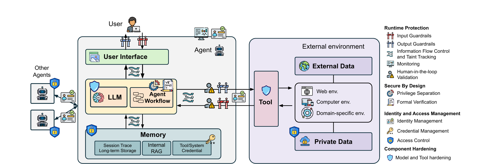

# Secure by design

Secure-by-design defenses establish security properties at the architectural level, making an agent intrinsically secure through fundamental design principles rather than by filtering what flows through it. Because these mechanisms depend on how a system is built, and because agents differ fundamentally from traditional systems, secure-by-design defenses are naturally unique to agentic systems: they cannot simply be inherited from the security engineering of conventional software. Figure 4 places them in the wider landscape, alongside runtime protection, identity and access management, and component hardening.

## Privilege separation

Following the principle of least privilege, traditional security enforces privilege separation by assigning different privilege levels to different software components, as earlier automation attempts did. In agents the same idea extends to assigning privileges to components and isolating those components so that the overall risk to the system is minimised. Privilege separation mitigates wrong instruction following (R2) by isolating untrusted data from decision-making components, and unconstrained data flow (R3) by enforcing boundaries between components with different trust levels.

### Representative works

AirGap separates the execution of the LLM by first retaining only task-relevant data in memory and then performing the task with this minimised memory, so that sensitive data is not exposed during execution. f-secure LLM, Camel and FIDES separate LLM operations into a tool call planning component and a tool result parsing component; by never feeding tool results directly into planning, they prevent external data from steering the agent's decisions. PFI separates tools and environments into normal and sandbox versions and switches execution privilege according to the level of data trust. IsolateGPT implements per-application privilege separation for mobile systems, spawning dedicated agents that interact only with application-specific tools and resources to prevent cross-application exploitation.

### Design dimensions

Privilege separation designs vary along two axes.

- Privilege separation policy. Vertical privilege separation implements hierarchical privileges, analogous to kernel and user separation; planner–parser separation isolates tool call planning from tool result parsing. Horizontal privilege separation instead runs parallel sub-agents at disjoint access scopes, as when IsolateGPT creates per-application agents that touch only that application's tools and resources.
- Scope. The components being separated differ from system to system. The LLM can be split into planning and parsing processes, so that tool results cannot directly influence planning decisions. Memory separation creates separate memory spaces and protects sensitive data from lower-privilege components. The external environment can reuse existing sandboxing mechanisms, such as the containerisation techniques of computer systems and fine-grained access control in web services.

### Limitations and open challenges

Current privilege separation research primarily addresses generic indirect prompt injection in simplified environments. It often fails to address the diverse and complex risks of real-world environments, such as the web, file systems and databases, which need specialised separation strategies. Privilege separation also entails utility loss, because splitting functionality across isolated components breaks the agent's capabilities apart. How to divide an agent into an effective set of least-privilege components remains an open problem, and designing efficient communication across isolated components that reduces the utility loss while preserving the security guarantees is an ongoing challenge for practical deployment.

## Provable security with formal verification

Traditional security employs formal verification to give a theoretical proof of correctness and security. In agentic systems, formal verification approaches instead develop formal models of stochastic agent behaviour and define verifiable properties within dynamic usage contexts.

### Representative works

Formal verification for agents remains a new area with very limited existing work. VeriSafe Agent is one of the few established approaches; it develops formal specifications for mobile GUI agents and verifies that their behaviour aligns with the user's initial intentions.

### Design dimensions

Formal verification approaches vary across formalisation target and security property.

- Formalization target. VeriSafe Agent formalises user intent into a domain-specific language over UI state transitions, verifying that proposed GUI actions align with the user's task before execution. Formal-LLM encodes developer-defined plan constraints, such as required tool orderings, as pushdown automata to restrict plan generation, ensuring validity and executability. ShieldAgent structures external policy documents, such as regulations or corporate rules, into declarative rule circuits over action trajectories to enforce policy compliance and safety.
- Security property. Contextual security ensures that the agent stays aligned with user intent and system policies. Safety property verification guarantees that its actions do not violate predefined safety constraints or cause harmful outcomes. Correctness property verification ensures that its behaviour conforms to specified functional requirements and produces the expected outputs.

### Limitations and open challenges

Traditional formal methods are designed for programs written in code with a structured language, whereas LLM-based agents operate on probabilistic models. That fundamental difference makes it hard to develop formal models that capture the stochastic behaviour of an agent while preserving meaningful security guarantees. The security properties of agents that interact with various environments, such as the web, file systems or mobile applications, also remain underspecified. Building formal verification frameworks that can address the full spectrum of agent security requirements largely remains an open challenge. In short, the difficulty is that the core of the system is a probability distribution rather than a program: any model exhaustive enough to be useful must describe how the model's outputs are distributed, yet the guarantees one would like to state are about individual actions taken in a particular context.

## Key points

- Secure-by-design defenses work at the architectural level rather than by filtering traffic, and their dependence on architecture makes them specific to agentic systems.
- Privilege separation mitigates R2 by isolating untrusted data from decision-making components and R3 by enforcing boundaries between components of different trust levels.
- Vertical separation is hierarchical, as in planner–parser splitting; horizontal separation runs parallel sub-agents at disjoint access scopes, as IsolateGPT does per mobile application.
- Separation costs utility, and both the least-privilege decomposition and the communication between isolated components remain open problems.
- Formal verification for agents is a new area with very limited work; VeriSafe Agent, Formal-LLM and ShieldAgent differ in what they formalise and which property they state.
- The open challenge for verification is that agents rest on probabilistic models, so a formal model must capture stochastic behaviour while still yielding meaningful security guarantees.
