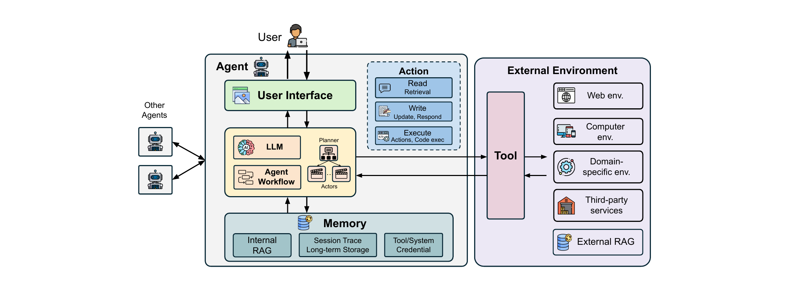

# Identity and access management

Identity and access management (IAM) spans identity management, access control and credential management, and exists to ensure that entities are authenticated and that resource access is authorised. Traditional systems use established frameworks such as role-based access control (RBAC) and OAuth-based delegation, and assume static user identities and predefined permission boundaries. Agentic systems instead act on behalf of users against real-world services, so they need agent-specific identities, delegation mechanisms and dynamic access control policies that adapt to the runtime context. That is the paper's §5.4; the two sections that follow it, component hardening (§5.5) and defense design principles (§5.6), harden the same components and tie the defense landscape together, so all three are covered here.

## Identity management

Identity management ensures that each actor operates under the correct identity, with user authentication and authorisation. In agent systems it gives fine-grained control over behaviour by defining agent identities and access scopes, and it must support delegation, auditability and regulatory accountability while aligning with existing standards. It mitigates the risks of illegal access (R5–R7) by ensuring that agent operations are properly authenticated and authorised.

### Representative works

Work here is limited. Okta and Composio offer single-sign-on (SSO) for agent access management, giving unified authentication and authorisation across multiple agent services.

### Design dimensions

- Architecture. Centralised systems rely on identity providers running on OpenID Connect; decentralised designs use distributed verification protocols and offer greater autonomy and resilience.
- Scope. User-level identity ties actions to a human user, agent-level identity gives each agent a distinct identity, and task-level identity creates short-lived identities for specific tasks or sessions to support dynamic, least-privilege operation.
- Delegation model. Direct delegation grants specific user permissions to agents, proxy delegation uses an intermediary service or tokens to act for a user, and temporary delegation provides time-limited access that automatically expires to limit risk.

### Limitations and open challenges

It remains unresolved whether an agent's actions should be attributed to the human operator, the agent instance or the task, and the answer varies by domain. Without standard frameworks, platforms implement incompatible credential issuance, delegation and revocation flows that are hard to audit or federate. Robust identity management needs interoperable taxonomies and lifecycle tooling that keep accountability while supporting agent collaboration.

## Access control

Access control can be enforced over internal memory and over external environments such as vector databases, file systems and cloud drives. Paired with identity management, it prevents unauthorised accesses (R5–R7) by limiting an agent to the resources and operations it may use.

### Representative works

Bedrock queries databases and filters results by the agent's access permissions, giving role-based access control for RAG-based agents. Honeybee dynamically partitions vector databases to balance the space–time trade-off, enabling efficient privilege enforcement at large scale. ControlNet uses internal neuron activations to enforce access control in vector databases, giving fine-grained permission management.

### Design dimensions

- Mechanism. Role-based access control (RBAC), attribute-based access control (ABAC), or capability-based security.
- Policy. From static permission rules to dynamic policies that adapt to changing contexts, user tasks and environmental state.
- Resource scope. Agent internal memory, external databases, tool APIs and file systems.

### Limitations and open challenges

Existing work targets retrieval-augmented LLM applications with vector databases, so agentic systems need broader coverage of tools, data sources and inter-agent interactions. Deployments lack adaptive policy frameworks that adjust to evolving tasks and trust contexts, and instead rely on ad hoc, non-uniform policies, creating mismatches across agents and gaps when coordinating with non-agentic services. Configuration complexity also leads to misconfigurations and excessive privileges even for technical users.

## Credential management

Agents manage tool API credentials (API keys and access tokens for third-party services) and environmental credentials (one-time passwords from email, session tokens). Exposure to these sensitive credentials raises privacy and security concerns and demands robust secret management. Credential management primarily mitigates private data leakage (R5).

### Representative works

OpenAI's temporary chat feature prevents chat history storage and model training usage, protecting credentials held in agent memory. Composio manages API keys and access tokens through single-sign-on, mitigating tool credential leakage. Authenticated delegation mechanisms based on OAuth 2.0 transfer credentials from users to agents securely.

### Design dimensions

The paper lists these dimensions as bullets and then repeats part of the list in a shorter form; the two readings agree, and the three dimensions below merge them.

- Confidential storage. Encrypted storage protects credentials at rest and prevents unauthorised access even if the storage medium is compromised; temporary storage keeps credentials only for the duration of active sessions, as OpenAI's temporary chat does; confidential computing manages credentials inside hardware-based trusted execution environments.
- Credential lifecycle management. Static management keeps credentials persistent throughout sessions, giving convenience and consistency but growing exposure over time; dynamic management uses time-limited tokens that expire automatically, shrinking the exposure window while requiring complex renewal and risking service interruptions.
- Credential provisioning. Single-sign-on mechanisms and OAuth 2.0 authenticated delegation determine how agents obtain credentials from users.

### Limitations and open challenges

Agent stacks still rely on ad-hoc secret handling. Many frameworks guide developers to store internal credentials such as API keys as unencrypted environment variables, increasing leakage risk. Multi-agent systems complicate secret sharing further, making least privilege and traceability hard to maintain.

## Component hardening

Component hardening strengthens individual components, the LLM and third-party tools, against their own vulnerabilities, on the recognition that an agent is only as secure as its weakest component. It is the paper's §5.5, and splits into model hardening and tool hardening.

Model hardening mitigates wrong instruction following (R2) and hallucination (R4) by improving robustness and reliability. SecAlign and StruQ fine-tune models to follow initial instructions even against conflicting directives; instruction hierarchy-aware model training keeps system prompts above user input and external data.

Tool hardening mitigates heterogeneous untrusted interfaces (R1) by ensuring tool integrity, verifying descriptions and preventing supply chain attacks through auditing. The Extended Tool Definition Interface (ETDI) signs and versions tool control cryptographically to prevent tool poisoning across the tool lifecycle. Anthropic's Connectors Directory curates trusted tools with reviewed descriptions, functionality and safety policies. MCP Context Protector inserts an MCP proxy that enforces manual review and guardrail checks. MCP Safety Audit examines agent tools with systematic protocols to find exploitable behaviour from malicious logic or misleading descriptions. MCIP adds observability to MCP and uses a fine-tuned LLM to detect threats in MCP usage.

### Limitations and open challenges

Current approaches address simplified threat scenarios that do not reflect real-world complexity. Instruction hierarchy fine-tuning handles simple system-prompt, user-prompt and tool-result scenarios but not sophisticated attacks such as shadowing attacks, in which malicious tool results override other tool results. The role of each component and the threat models appropriate for hardening it remain unclear.

## Defense design principles

Effective agent security needs multiple complementary mechanisms, and the paper distils three principles. It notes that further principles also apply to agents, such as fail-safe defaults and economy of mechanisms.

Defense-in-depth. Mechanisms complement each other by acting at different stages and against different attack vectors. Input guardrails are the first line and output guardrails the last; information flow control and monitoring give continuous runtime protection; access control ensures authentication and authorisation; privilege separation and other secure-by-design approaches give architectural protection; component hardening strengthens individual elements; and human-in-the-loop validation gives user oversight for critical decisions.

Least privilege. Agents should hold the minimal necessary permissions, implemented through privilege separation techniques that isolate components and restrict tool access to what a task requires.

Complete mediation. All access to sensitive resources should be checked and validated, reflected in monitoring systems and in access control that verifies every interaction with a protected resource.

These principles act on the risk clusters that the design dimensions of §3 amplify. The paper's §4.2 maps the dimensions to risks: input trust, memory and tool increase the attack surface (R1); workflow drives the model risks (R2, R3, R4); and access sensitivity, action and user interface determine the severity of the consequence risks (R5, R6, R7). Greater flexibility on any dimension amplifies risk, and the design dimensions of the mechanisms themselves are where that structure reappears: privilege separation's scope names memory separation and environment sandboxing, access control's resource scope names internal memory, external databases, tool APIs and file systems, and credential management's storage dimension names memory and tool credentials. Each principle names the mechanism that holds one risk cluster down.

## Key points

- IAM covers identity management, access control and credential management; agents need agent-specific identities, delegation and dynamic policies beyond traditional RBAC and OAuth.
- Identity management is centralised or decentralised, scoped to user, agent or task, with direct, proxy or temporary delegation; it mitigates R5–R7, and interoperability and attribution remain open.
- Access control acts over internal memory and external environments through RBAC, ABAC or capability mechanisms; it mitigates R5–R7 but covers vector-database RAG systems far better than tools, inter-agent interactions and non-agentic services.
- Credential management covers tool API and environmental credentials including session tokens, mitigating R5 through confidential storage, lifecycle management, and SSO or OAuth 2.0 provisioning.
- Component hardening (§5.5) hardens the model against R2 and R4 and tools against R1, and neither handles sophisticated attacks such as shadowing.
- Defense design principles (§5.6) are defense-in-depth, least privilege and complete mediation, acting on the risk clusters that the §3 design dimensions amplify.
