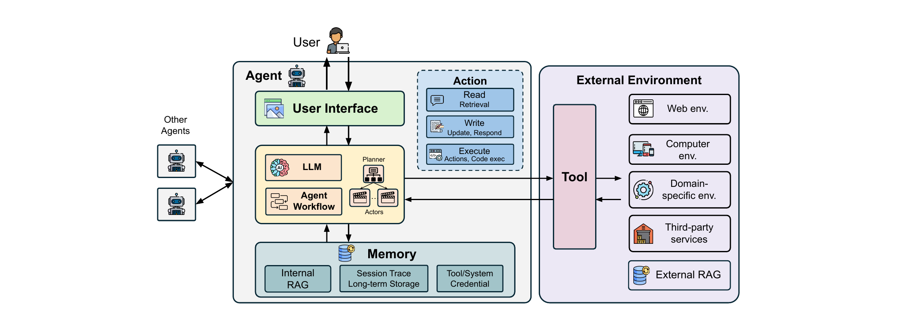

# 从语言模型到智能体系统

**AI 智能体**是一种混合软件系统，它把传统软件组件与神经组件组合在一起。这个定义建立在文献中已有的智能体定义之上 [35, 72, 114, 135]，并为后续的安全分析做了取舍。本章要把这个定义落到实处——一个智能体由哪些部件组成、它们如何拼接、以及结果与普通软件究竟差在哪里——因为整条安全论证都建立在这个定义之上。

## 范围

本工作聚焦的，是相对于传统软件和独立 LLM 而言，智能体系统所独有、或被显著放大的安全风险与防护。它先刻画智能体在七个设计维度上如何区别于独立模型（§3），再在组件层与系统层两个层面分析智能体特有的安全风险（§4）。对于同样存在于非智能体 LLM 中的风险——越狱与幻觉——它强调智能体的自主性与环境访问如何放大其影响：越狱会变成数据外泄，幻觉会变成对系统的意外操纵。针对模型内部机制的攻击（如模型反演 [38]）被排除在外，因为在智能体场景中智能体只经由推理期的输入输出接口工作，这类攻击并不会实质恶化。防护图景则在 §5 中系统化。

## 方法

智能体结构与设计维度，是根据已有定义和真实世界的智能体实现归纳出来的。这个定义为智能体风险分类奠定了基础，该分类在组件层和系统层两级分析风险，并参考了 OWASP LLM 应用十大风险 [104] 与 MITRE ATLAS 矩阵 [25] 的分类。在此基础上，防护图景依循纵深防御原则、并借鉴传统系统安全提出。

在这套框架之上，本工作综述了 2023 年至 2025 年 10 月间有关智能体 AI 安全的学术文献与网络文档，这段时间正对应智能体系统的扩散期 [150]。检索围绕四个维度的关键词展开：通用术语（agent security）、OWASP 定义的风险（prompt injection、memory poisoning）、以组件为中心的术语（RAG security、tool security）、以及传统安全的改造（isolation、access control）。检索优先考虑顶级安全会议（USENIX Security、IEEE S&P、CCS、NDSS）与机器学习会议（NeurIPS、ICLR、ICML），并兼顾高影响力预印本、行业白皮书与 CVE。针对独立模型的工作被人工剔除，只保留与智能体相关者。综述共得到 128 篇论文，其中攻击方法 51 篇、防护方法 60 篇；其余工作同时涉及攻击与防护，或属于不提出新方法的案例研究。

## 与既有综述的区别

既有的 AI 与 LLM 安全综述强调模型层威胁，忽略了智能体系统带来的攻击面扩张与下游后果 [49, 58, 81, 138]。此前的智能体研究往往把范围缩小到特定攻击向量 [155]、智能体类型 [65, 73] 或单个组件 [52]，而面向设计的工作只提出高层原则，并未系统化攻击或防护 [12, 156]。最接近的几篇综述 [31, 151] 虽然考虑了跨组件交互，但其防护分类基本限于基于模型的技术。本工作则给出覆盖全部智能体组件及其交互的统一风险分类，并提供一个把基于模型的防护与系统级防护融合起来的纵深防御框架。

## AI 智能体的结构

一个智能体由少量部件搭成。LLM 是大脑：一个或多个 LLM 接收并分析用户任务，制订分步计划，并依计划采取动作；这些过程既可以由一个 LLM 完成，也可以由多个各司其职的 LLM 分担。与 LLM 并列的是智能体工作流，它把 LLM 决定的步骤编排成序列；LLM 与工作流共同构成智能体的决策核心。记忆存储智能体的内部知识库与历史动作轨迹，其中可能包含过去的经验与观察；这些信息通常被向量化以便高效检索，使智能体能依据知识与先验经验做后续决策。在结构中，记忆表现为内部 RAG、会话轨迹、长期存储以及工具/系统凭据。

工具是智能体用来与外部环境交互的符号函数。借助工具，智能体可以执行三类动作：读、写、执行，这正是它的动作空间。检索类工具对外部环境提供只读访问，例如搜索或读取文件；会修改环境的工具，例如写文件、发邮件或运行命令，则同时具有读、写与执行权限。工具可以通过标准化协议（如 MCP [6]）实现，也可以由智能体设计者或第三方提供方实现 [8, 105]。

用户界面是用户与智能体交互的界面，从纯文本交互，到基于网页的预览与媒体渲染，再到完全可交互的网页元素。它位于用户与智能体之间，在多智能体场景中也是其他智能体接入的位置。

外部环境是智能体完成任务时所处的外部语境。不同智能体在不同环境中工作：网页智能体通常与浏览器交互，代码智能体则在集成开发环境（IDE）中运行。智能体通过工具触及环境，例如访问、读取和写入 SQL 数据库。环境可细分为若干子环境：网络、计算机、领域专用环境、第三方服务以及外部 RAG。用户查询经用户界面进入，决策核心规划并选择动作，动作再经工具作用于环境。多智能体系统拥有多个这样的决策核心，每个核心都有自己的记忆、系统提示与工具集。

智能体接收用户查询后，会自动采取一系列动作来帮助用户。LLM 部件负责任务规划并决定不同任务该采取哪些动作，包括工具调用、内容生成与查询记忆。例如要求更新一个文件时，智能体会先调用文件读取工具，根据读到的内容生成新的文件内容，再调用文件写入工具更新该文件。

## 智能体系统与传统软件系统的差异

智能体系统相对传统系统的独特性，关键在于其组成与工作流。在组成上，智能体系统把传统软件程序与 AI 模型结合，而传统系统主要运行于源码中预先确定的程序逻辑之上；模型的存在让智能体系统更灵活、更具适应性。在工作流上，传统软件的控制流主要是预先编排好的，而智能体系统运行于动态生成的工作流之上，操作顺序在运行时才决定，而非事先固定。

## 作为组织轴线的设计灵活性

上述两点差异出自同一个性质：灵活性。一个智能体的设计可以沿七个维度落在灵活性的连续谱上——输入信任、访问敏感性、工作流、动作、记忆、工具、用户界面。每个维度都从最不灵活、经中等灵活，到最灵活排列。输入信任从无外部数据到任意外部数据；访问敏感性从无敏感数据到任意敏感数据；工作流从简单的聊天机器人到 LLM 定义的动态工作流；动作从仅生成回复到回复、检索与执行；记忆从无记忆到跨会话的持久记忆；工具从无工具到任意工具；用户界面从纯文本到可交互的网页元素。这些维度彼此正交：同一个智能体可以在不同维度上处于不同层级。

这条灵活性轴线正是整套知识梳理的组织依据。把一个维度推向最灵活的一端，在换来能力的同时也扩大了攻击面与失败传播的距离。攻击图景与防护图景都是从这条轴线读出来的。第 3 章将详细展开这七个维度及其安全后果。

## 本章要点

- AI 智能体是把传统软件组件与神经组件组合起来的混合软件系统，该定义建立在已有定义之上并为安全分析做了取舍。
- 其部件包括作为决策核心的 LLM 与智能体工作流、记忆、工具、用户界面与外部环境；多智能体系统含有多个这样的核心，各有自己的记忆、提示与工具集。
- 智能体动作分三类——读、写、执行——其中检索类工具提供只读访问，修改类工具则同时拥有读、写与执行权限。
- 外部环境细分为网络、计算机、领域专用环境、第三方服务与外部 RAG 等子环境。
- 智能体系统与传统软件的差异在组成（AI 模型与预先确定的程序逻辑并存）与工作流（动态生成而非预先编排）两方面。
- 七个设计维度构成一条灵活性连续谱，它是整套风险与防护分析所围绕的组织轴线。
- 其方法综述了 128 篇论文，其中攻击方法 51 篇、防护方法 60 篇，覆盖 2023 年至 2025 年 10 月的工作。
