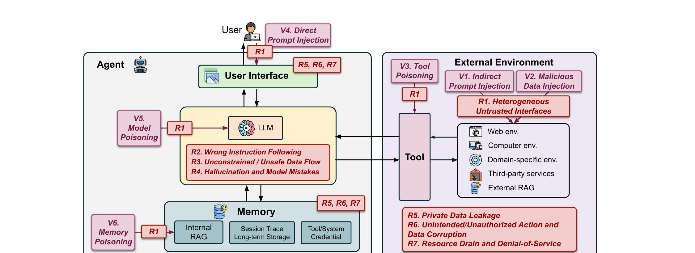

# 攻击向量

攻击者进入一个智能体系统的入口并不多。论文把这些入口归为六个攻击向量，记作 `V1` 到 `V6`，划分依据是攻击者必须控制什么，并且为每个入口配上它会造成的安全风险。图 2 给出了整体图景：黑色方框与箭头表示智能体的组件和数据流，紫色方框与箭头表示攻击向量及其进入系统的路径，红色方框表示安全风险。

## 威胁模型

智能体生态的参与者众多，攻击者与受害者在不同场景下并不相同。论文按能力把对手分成三类，并把每类对手能实施的向量归到它名下。

### 外部对手

外部对手无法与智能体直接交互。它能控制的是智能体之后可能读取的外部世界：公开网页、文档，以及智能体检索和处理的其他资源。它是三类模型中受限最多、也最贴近现实的一种，因为它完全不假设对智能体系统有访问权限。它对应 `V1`、`V2` 和 `V3`。

### 用户级对手

用户级对手能直接接触智能体并向它投喂恶意输入。这名对手要么是恶意用户，要么是污染了正常用户输入的第三方。它对应 `V4`。

### 内部对手

内部对手可以访问智能体的组件，从内部攻破智能体。它可能是智能体开发者，也可能是负责某个组件（例如记忆或模型）的第三方供应商。论文明确指出，这类攻击在实践中是最难实现的。它对应 `V5` 和 `V6`。

## 攻击向量

图 2 中每一条向量箭头的落点都是 `R1`，即异构的不可信接口：无论走哪条向量，它带来的第一层风险都是暴露出一个让不可信数据进入智能体的接口。图中还在用户界面、工具与记忆的边界标出 `R5`、`R6` 和 `R7`，即这些数据再次流出系统之处。4.3 节给出了连接两端的级联关系：攻击面扩大（`R1`）让攻击者控制的数据抵达模型风险（`R2` 错误指令跟随、`R3` 无约束的数据流、`R4` 幻觉与模型错误），模型风险再放大后果类风险 `R5`、`R6`、`R7`。

### V1. 间接提示注入

攻击者构造一段智能体将会检索到的内容，并把指令藏进去。智能体读到这段内容后，注入的指令会与用户真实目标争夺支配权，把智能体推向谁都没有要求的动作，通常是对智能体用户数据或智能体供应商内部资源的未授权访问。投递渠道是智能体从外部摄入的一切：检索到的网页内容、文档、邮件，以及工具返回的结果。论文的事故记录本身就包含这一模式，即用提示注入访问私有 GitHub 仓库 [54]；引言还提到攻击者通过恶意文档附件与邮件转发实施数据外泄 [112, 117]。被点名引用的前期工作包括 Greshake 等人用间接提示注入攻破真实世界 LLM 集成应用的工作 [48]，以及面向工具集成式 LLM 智能体的间接提示注入基准 InjecAgent [153]。附录 A 把 `V1` 对应到三项 MITRE ATLAS 技术：Retrieval Content Crafting、Drive-by Compromise 和 Prompt Infiltration via Public-Facing Applications。`V1` 从外部环境进入，终止于 `R1`。

### V2. 恶意数据注入

这一向量注入的是数据，而不只是提示词。区别在于，注入的数据根本不需要读起来像一条命令：它只要在一次敏感操作中被使用，就能触发安全失效或数据泄露。论文给出两种形态。其一是恶意软件包，攻击者注册一批代码生成模型经常幻觉出来的包名，把模型自身的局限变成一条稳定的供应链通道 [127]，这正是 4.2 节与 `R4` 联系起来的那种利用。其二是为敏感参数提供由攻击者给出的取值，例如 Web3 智能体据以行动的金融参数 [106]。`V2` 从外部环境进入，终止于 `R1`。

### V3. 工具投毒

攻击者提供一个第三方工具。载荷可以藏在两个位置之一。其一是文本，即嵌入在工具名称或描述里的恶意提示词，模型在判断是否调用、如何调用该工具时会读到它；其二是工具的实现本身，也就是工具里直接含有恶意代码。描述这一条通道正是本向量区别于 `V1` 的地方：载荷不需要从环境中被检索出来，它随智能体所加载的工具定义一起到达。论文引用了多工具 LLM 智能体中的跨工具窃取与污染工作 [74]、关于 MCP 服务器如何攻击使用者的报告 [96]，以及针对 LLM 智能体工具选择的攻击 [121]。`V3` 经由工具组件进入，终止于 `R1`。

### V4. 直接提示注入

用户级对手写下一段提示词，指示智能体去做系统提示词所禁止的动作，恶意指令因此是直接到达的，而不是经由检索内容。这名对手是恶意用户，或者是污染正常输入的第三方。论文引用了成串的提示注入工作：自动且通用的提示注入攻击 [79]、针对 LLM 集成应用的提示注入 [80]、Perez 与 Ribeiro 的 "Ignore previous prompt" 攻击技术 [107]，以及目标引导的生成式提示注入 [154]。两篇"污染用户输入"方向的工作是 Imprompter，它诱骗 LLM 智能体不当使用工具 [39]，以及通过扰动模型所感知内容来滥用工具的视觉对抗样本方法 [40]。附录 A 把 `V4` 等同于 ATLAS 技术 LLM Prompt Injection。`V4` 从用户界面进入，终止于 `R1`。

### V5. 模型投毒

攻击者把隐藏的恶意行为嵌入模型本身，使模型执行未授权动作或泄露用户数据。攻击者处在系统内部，是模型供应商或模型供应链上的第三方，这也正是本向量归属于内部对手、因而归属于论文所称"实践中最难实现"的那一类攻击的原因。附录 A 把 `V5` 展开为三项 MITRE ATLAS 技术：Poison Training Data、Publish Poisoned Datasets 和 Publish Poisoned Models。论文为本向量引用了 [19] 与 [91]。`V5` 从 LLM 进入，终止于 `R1`。

### V6. 记忆投毒

攻击者直接操纵智能体的记忆，注入恶意内容、改变智能体的行为，或泄露隐私数据。记忆是它区别于一次性注入的关键：它存放内部 RAG、会话轨迹、长期存储与工具或系统凭据，并跨会话持续存在，一次写入会活得比写下它的那次对话更久。论文引用了通过污染记忆或知识库对 LLM 智能体做红队测试的 AgentPoison [21]、针对 LLM 智能体的实用记忆注入攻击 [34]，以及破坏检索增强生成知识的 PoisonedRAG [162]。附录 A 把 `V6` 展开为 ATLAS 技术 RAG Poisoning、False RAG Entry Injection 和 AI Agent Context Poisoning。`V6` 从记忆组件进入，终止于 `R1`。

## 本章要点

- 论文按能力把对手分为三类：外部对手对智能体系统无访问权限，只能影响智能体可能检索的资源；用户级对手直接投喂恶意输入；内部对手可访问模型、记忆等组件。
- 外部对手对应 `V1`、`V2`、`V3`，用户级对手对应 `V4`，内部对手对应 `V5` 与 `V6`；论文称内部对手的攻击在实践中最难实现。
- `V1` 间接提示注入经由智能体检索到的内容投递指令，渠道包括网页、文档、邮件与工具返回结果。
- `V2` 恶意数据注入提供的是数据而非指令，例如被幻觉出的包名或攻击者给定的敏感参数取值，只有在敏感操作中被使用时才产生危害。
- `V3` 工具投毒把载荷藏在第三方工具的名称、描述或实现中，载荷随工具定义一同到达，无需经过检索。
- `V4` 直接提示注入来自用户或用户界面，违背系统提示词；论文将其等同于 MITRE ATLAS 的 LLM Prompt Injection。
- `V5` 模型投毒对应 ATLAS 的 Poison Training Data、Publish Poisoned Datasets 与 Publish Poisoned Models，`V6` 记忆投毒对应 RAG Poisoning、False RAG Entry Injection 与 AI Agent Context Poisoning。
- 图 2 中每条向量都终止于 `R1`，`R5`、`R6`、`R7` 标在用户界面、工具与记忆边界；4.3 节说明 `R1` 如何导向 `R2`–`R4` 并放大为 `R5`–`R7`。
