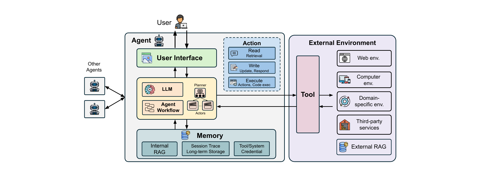

# 身份与访问管理

身份与访问管理（IAM）包含身份管理、访问控制与凭证管理，确保实体经过认证、资源访问获得授权。传统系统依赖 RBAC、OAuth 委托等成熟框架，假定身份静态、权限边界预先划定。智能体代表用户与真实服务交互，需要专属的身份、委托机制，以及随运行时语境调整的动态访问控制策略。这对应论文 §5.4；其后的组件加固（§5.5）与防护设计原则（§5.6）加固同一批组件，一并收入本章。

## 身份管理

身份管理确保每个行为主体在正确身份下运行并完成认证与授权。它通过定义智能体身份与访问范围，实现对行为的细粒度控制，并须支持委托、可审计性与监管问责，与既有标准对齐。它通过保证智能体操作经过恰当的认证与授权，缓解非法访问（R5–R7）。

### 代表性工作

这方面工作有限。Okta 与 Composio 为智能体访问管理提供单点登录（SSO），在多个智能体服务之间统一认证与授权。

### 设计维度

- 架构。集中式依赖运行在 OpenID Connect 上的身份提供方；去中心化设计采用分布式验证协议，自主性与韧性更强。
- 范围。用户级把动作绑定到真人，智能体级为每个智能体分配独立身份，任务级为任务或会话创建短生命周期身份，支持动态最小权限。
- 委托模型。直接委托把用户的具体权限授予智能体，代理委托经中间服务或令牌代表用户行事，临时委托提供到期自动失效的限时访问以限制风险。

### 局限与开放挑战

智能体的动作应归于人类操作者、智能体实例还是任务，仍未解决。缺少标准框架时，各平台的凭证签发、委托与撤销流程互不兼容，难以审计与联邦。稳健的身份管理需要可互操作的分类体系与生命周期工具。

## 访问控制

访问控制既作用于内部记忆，也作用于向量数据库、文件系统、云盘等外部环境。与身份管理配合，它把智能体限制在被允许的资源与操作上，防止未授权访问（R5–R7）。

### 代表性工作

Bedrock 按智能体权限查询并过滤数据库结果，为 RAG 智能体提供基于角色的访问控制。Honeybee 对向量数据库动态分区，平衡访问控制的时空开销。ControlNet 利用内部神经元激活值在向量数据库中实施访问控制。

### 设计维度

- 机制。基于角色的访问控制（RBAC）、基于属性的访问控制（ABAC）或基于能力的安全系统。
- 策略。从静态权限规则到随语境、任务与环境状态调整的动态策略。
- 资源范围。智能体内部记忆、外部数据库、工具 API 与文件系统。

### 局限与开放挑战

现有工作主要面向带向量数据库的检索增强 LLM 应用，智能体系统还需覆盖更多样的工具、数据源与智能体间交互。部署缺少随任务与信任语境调整的自适应策略，只能依赖临时而不统一的策略，造成智能体间不匹配、与非智能体服务协作有缺口，配置复杂也使技术用户误配与权限过大。

## 凭证管理

智能体管理工具 API 凭证（第三方服务的 API 密钥与访问令牌）与环境凭证（邮件中的一次性口令、会话令牌）。接触这些凭证带来隐私与安全问题，需要稳健的密钥管理实践，它主要通过安全地存储与处理敏感凭证缓解私有数据泄露（R5）。

### 代表性工作

OpenAI 的临时聊天阻止保存聊天记录与用于训练，保护记忆中的凭证。Composio 用 SSO 管理 API 密钥与访问令牌，缓解工具凭证泄露。基于 OAuth 2.0 的认证委托把凭证从用户安全转交给智能体。

### 设计维度

论文把该清单列了两遍，两种写法一致，下列三项是合并结果。

- 机密存储。加密存储保护静态凭证，介质被攻破也无法被未授权读取；临时存储只在活跃会话期间保留凭证，如 OpenAI 临时聊天；机密计算在基于硬件的可信执行环境中管理凭证。
- 凭证生命周期管理。静态管理在整个会话期保持凭证，便利一致但暴露风险随时间增长；动态管理使用到期自动失效的限时令牌，缩小暴露窗口，却需要复杂续期并可能中断服务。
- 凭证供给。单点登录机制与基于 OAuth 2.0 的认证委托，决定智能体如何从用户取得凭证。

### 局限与开放挑战

智能体技术栈仍依赖临时性密钥处理，缺少标准做法；许多框架让开发者把 API 密钥以未加密环境变量保存，抬高泄露风险；多智能体系统又使密钥共享更难，最小权限与可追溯性难以维持。

## 组件加固

组件加固针对 LLM、第三方工具等组件自身的漏洞加以强化，因为智能体只与其最薄弱组件一样安全。这是论文 §5.5，分模型加固与工具加固。

模型加固通过提升鲁棒性与可靠性，缓解错误指令跟随（R2）与幻觉（R4）。SecAlign 与 StruQ 微调模型，使其面对冲突指令仍遵循最初指令；指令层级感知训练让系统提示保持对用户输入与外部数据的优先级。

工具加固通过保证工具完整性、核验描述并以系统审计防止供应链攻击，缓解异构不可信接口（R1）。扩展工具定义接口（ETDI）用密码学签名与版本控制管控工具，防止工具投毒。Anthropic 的 Connectors Directory 维护可信工具策展仓库。MCP Context Protector 以 MCP 代理强制人工审核与护栏检查。MCP Safety Audit 以系统化协议检查工具，找出恶意逻辑或误导描述带来的可利用行为；MCIP 则为 MCP 增加可观测性并用微调 LLM 检测威胁。

### 局限与开放挑战

现有方法针对简化威胁场景，不反映真实系统复杂性。指令层级微调只应对系统提示、用户提示与工具结果的简单场景，处理不了遮蔽攻击——恶意工具结果覆盖其他工具结果。各组件扮演何种角色、用何种威胁模型才能全面加固，仍不清楚。

## 防护设计原则

有效的智能体安全需要多种互补机制。论文提炼三条原则，并指出故障安全默认值、机制经济性等也适用于智能体。

纵深防御。各机制在不同阶段、针对不同攻击向量，因而互补。输入护栏是第一道防线，输出护栏是最后一道；信息流控制与监控提供运行时防护；访问控制保证认证与授权；权限分离等安全设计提供架构防护；组件加固强化单个要素，人在环路为关键决策提供监督。

最小权限。智能体应只持有必要的最小权限，通过权限分离技术实现：隔离组件，并把工具访问限制在任务所需范围。

完全中介。对敏感资源的一切访问都须检查与验证，体现在全面监控，以及验证每次受保护资源交互的访问控制上。

这三条原则作用的正是 §3 设计维度所放大的风险簇。论文在 §4.2 中映射：输入信任、记忆与工具扩大攻击面（R1）；工作流主导模型风险（R2、R3、R4）；访问敏感度、动作与用户界面决定后果风险（R5、R6、R7）的严重程度。维度越灵活风险越大，各防护机制的设计维度也呼应这些维度，如访问控制的资源范围即内部记忆、外部数据库、工具 API 与文件系统。

## 本章要点

- IAM 涵盖身份管理、访问控制与凭证管理；智能体需要专属身份、委托与动态策略，传统 RBAC 与 OAuth 无法独自满足。
- 身份管理可集中或去中心化，范围落在用户、智能体或任务，委托有直接、代理、临时三种；它缓解 R5–R7，互操作性与归属仍未解决。
- 访问控制作用于内部记忆与外部环境，机制有 RBAC、ABAC 与能力式，缓解 R5–R7，但覆盖向量数据库 RAG 优于工具与智能体间交互。
- 凭证管理覆盖工具 API 凭证与会话令牌等环境凭证，以机密存储、生命周期管理及 SSO 或 OAuth 2.0 供给缓解 R5。
- 组件加固（§5.5）让模型抵御 R2、R4，工具抵御 R1，两者都处理不了遮蔽攻击这类复杂手法。
- 防护设计原则（§5.6）为纵深防御、最小权限与完全中介，作用于 §3 设计维度所放大的风险簇。
