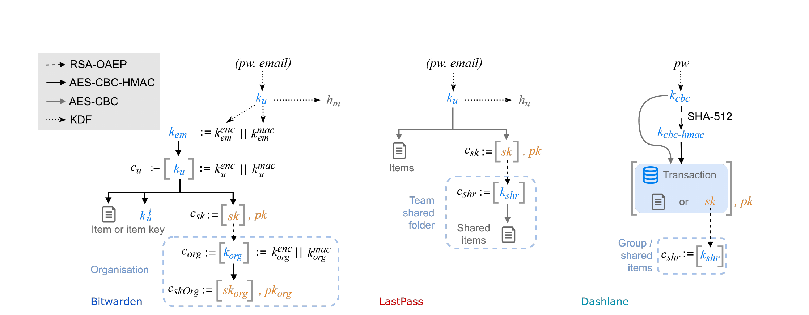

# 攻击三 — 共享功能

共享是四类攻击中的第三类，也是讲者在报告中认为可以借用即时通信领域已有原语来解决的一类。讲者按密钥恢复、部分保险库同步、共享、向后兼容的顺序组织这些高风险功能，而对共享只推荐一条对策：以密钥透明（key transparency）的形式实现公钥认证。下面的攻击说明了原因。三款管理器都实现了某种共享，也都因为同一个原因失败——客户端会接受服务器交给它的公钥，却无法核实这把公钥属于谁。四类攻击的影响范围不同：LastPass 与 Dashlane 的漏洞只影响正在被共享的那些条目，而 Bitwarden 的漏洞会促成部分密钥托管攻击，后果更远。

## Bitwarden：组织

Bitwarden 的凭据共享通过"组织"实现。用户创建组织时，客户端随机采样一个 64 字节的组织对称密钥 $k_{org}$，用创建者的 RSA 公钥加密得到 $c_{org}^{user}$；同时生成用于账户恢复的组织 RSA 密钥对 $(pk_{org}, sk_{org})$，并用 $k_{org}$ 加密其私钥得到 $c_{skOrg}$。$c_{org}^{user}$、$pk_{org}$ 与 $c_{skOrg}$ 一并发送给服务器。组织内的条目各自用 $k_{org}$ 单独加密。添加成员时，把 $k_{org}$ 用被邀请者的公钥加密：密文 $c_{org}^{user'}$ 由服务器保存，并在 $user'$ 下次同步时下发，其客户端用自己的 RSA 私钥解密即可得到 $k_{org}$。客户端判断某用户是否为组织成员，标准正是它能否取得 $k_{org}$；组织的名称与账户恢复策略则是不加密的服务器数据，每次同步都会送达。

这个设计缺了两样东西。其一，没有任何密码学绑定把用户的保险库（甚至保险库这一抽象）与其所属组织联系起来，客户端只是照单全收服务器下发的组织列表。其二，组织对称密钥的那些加密副本完全未经认证，任何人都可以把一把自己选定的对称密钥加密到任意用户的公钥之下。

### BW08：组织注入

因此，把某个用户加入组织只需要该用户的公钥，而服务器本来就掌握它。敌手新建一个组织，把它的 $k_{org}$ 加密到目标用户公钥之下，客户端就会在下一次同步时默默接受这个新组织。作为推论，敌手还能把任意用户加入任何它知道对称密钥的组织。影响是保险库完整性被破坏：组织条目被塞进用户的保险库，可用于陷害类攻击（例如栽赃材料），并为后续若干攻击（尤其是 BW03 与 BW09）铺路。触发条件是客户端执行一次同步——客户端在启动时、打开保险库页面时、响应某些用户操作时以及收到服务器事件时都会自动同步。

### BW09：组织覆写

组织一经创建，创建者的客户端就会同步以获取服务器上的最新数据，其间会取回新建组织的密钥。同步完成后，创建者便能用自己的 RSA 私钥解密组织对称密钥，进而解密全部组织数据。敌手可以介入这一窗口：沿用 BW08 的手法，把加密的对称密钥 $c_{org}$ 和组织数据替换成自己控制的值，而客户端在同步时无法把这样的恶意密钥与合法密钥区分开。与新建组织的 BW08 不同，这种攻击完全无法检测。敌手也可以在组织创建之后再覆写，但那会删掉已有的组织条目。影响是敌手能够读取并修改新建组织中的全部条目；触发条件是用户创建组织。

## LastPass：共享文件夹

LastPass 用共享文件夹实现共享。用户首次共享条目时，客户端采样一个 32 字节的共享文件夹密钥 $k_{shr}$，文件夹内的条目用它以 AES-CBC 加密；文件夹密钥本身再用 RSA-OAEP 加密到每一位共享对象的公钥之下。

### LP07：共享密钥覆写

在一次由用户发起的条目共享过程中，服务器（即敌手）会用一个由敌手控制的接收方 RSA 公钥，替换掉原本那一位接收方的公钥。客户端和用户都无法把恶意密钥与目标密钥区分开：接收方的 RSA 公钥未经认证，界面不提供任何带外核对密钥指纹的途径，也没有实现密钥透明。影响是敌手可以读取并修改共享文件夹内的全部条目；触发条件是用户与任意接收方共享一个条目。

## Dashlane：用户与群组共享

Dashlane 同样用公钥加密实现共享，因此 LP07 中的"未认证公钥"问题也适用于它。客户端把条目共享给某个用户或在群组内共享时，会采样一把新的对称共享密钥 $k_{shr}$：用户对用户的共享中它直接加密被共享条目，群组共享中它加密群组密钥，再由群组密钥保护共享条目。无论哪种情形，共享方客户端都从服务器取回接收方的 RSA 公钥，且不核实其真实性，就把 $k_{shr}$ 加密到每一位接收方的公钥之下，得到各自的 $c_{shr}^{user}$，再把它们发送给服务器保存。

### DL02：共享密钥覆写

当共享方客户端请求某位接收方的公钥时，敌手可以把它覆写成自己掌握的一把 RSA 公钥 $pk^{adv}$，使 $k_{shr}$ 被加密到这把恶意公钥之下。由此得到的密文 $c_{shr}^{adv}$ 会被送回敌手，敌手用 $sk^{adv}$ 解密便恢复出 $k_{shr}$，进而取得它所保护的共享条目。影响是敌手可以读取并修改全部共享条目；触发条件是用户与任意接收方共享一个条目。

## 同一成因，四种攻击

四种攻击都源自同样的两个成因。表 1 为它们都记录了"缺乏密钥认证"（Lack of Key Auth），并为 BW09、LP07、DL02 追加了"密钥替换"（Key Substitution）。

| 编号 | 名称 | 成因 | 影响 | 交互 | 缓解 |
| --- | --- | --- | --- | --- | --- |
| BW08 | 组织注入 | 缺乏密钥认证 | 向任意组织添加用户 | 1 次同步 | SC |
| BW09 | 组织覆写 | 缺乏密钥认证、密钥替换 | 组织失陷 † | 1 次加入 | PKA、SC |
| LP07 | 共享密钥覆写 | 缺乏密钥认证、密钥替换 | 共享保险库失陷 † | 1 次加入 | PKA |
| DL02 | 共享密钥覆写 | 缺乏密钥认证、密钥替换 | 共享保险库失陷 † | 1 次加入 | PKA |

表中带 † 的攻击表示可以恢复出加密的密码。在这一维度上四种攻击差别很大。BW08 只破坏完整性：它往保险库里塞条目，读不到任何东西。BW09、LP07、DL02 则同时给出读取与修改的权限——对象分别是新建组织、共享文件夹或共享条目——因此它们既破坏完整性也破坏机密性，也是能够恢复共享秘密明文的攻击。它们都不能直接恢复主密码，但 BW09 是一个跳板而非终点：它把新建组织的完整控制权交给敌手，从而接上密钥托管那一类攻击，而账户接管正是在那里完成的。

表 1 也给出了解法。公钥认证（PKA）——在可选的带外核对后把已知公钥缓存进保险库，或改由一个不受密码管理器服务器控制的证书机构签发——可以消除 LP07 与 DL02，也能一并覆盖密钥托管所使用的管理员与组织公钥。BW09 需要 PKA 与密文认证（SC）配合，因为客户端还必须能判断某个自称组织邀请的密文确实出自用户本人；签密，或索性用对称认证加密取代公钥加密，都能做到这一点。BW08 单靠 SC 即可缓解。讲者的概括只有一句：共享正是密码管理器需要密钥透明的地方。

## 本章要点

- 三款管理器都以"用接收方 RSA 公钥加密一把按共享划分的对称密钥"（Bitwarden 是 $k_{org}$，LastPass 与 Dashlane 是 $k_{shr}$）来实现共享，且都不认证这些公钥。
- BW08（组织注入）让敌手把用户加入任意组织，破坏保险库完整性并促成 BW03、BW09，只需一次自动同步。
- BW09（组织覆写）把新建组织的加密组织密钥换成敌手选定的值，完全无法检测，令敌手可读取并修改整个新组织。
- LP07 使恶意服务器能在共享时替换接收方公钥，从而读取并修改共享文件夹内的全部条目。
- DL02 对 Dashlane 做了同样的事，还让敌手用 $sk^{adv}$ 解密 $c_{shr}^{adv}$ 直接恢复 $k_{shr}$。
- BW08 只破坏完整性；BW09、LP07、DL02 同时破坏机密性并恢复共享数据明文，其中 BW09 是通向密钥托管攻击类的跳板。
- 表 1 给出的缓解手段是公钥认证（PKA）与密文认证（SC），后者以签密或对称认证加密实现。
